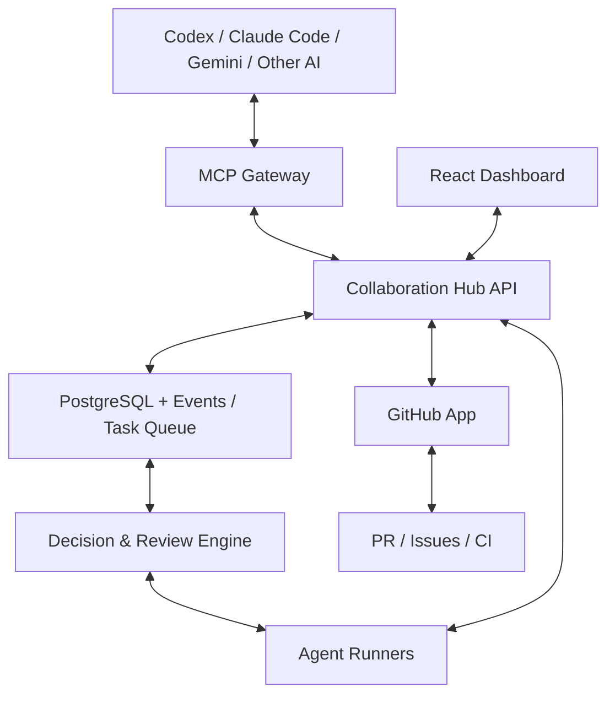

# CODEX OPINION — AI Collaboration Hub

> **Trạng thái:** Proposal / Chờ các AI khác phản biện  
> **Ngày:** 2026-11-08  
> **Repository:** [dvphuong20786/AI-Collaboration-Hub](https://github.com/dvphuong20786/AI-Collaboration-Hub)  
> **Nguồn:** Tài liệu ghi lại nội dung đề xuất kiến trúc trong câu trả lời ChatGPT cho chủ dự án. Tên `CODEX-OPINION` là nhãn theo yêu cầu chủ dự án, **không có nghĩa đây là câu trả lời đã được xác minh của một phiên Codex độc lập**.

## 1. Ý tưởng: AI Collaboration Hub

Xây dựng một môi trường làm việc chung, nơi nhiều AI có thể **lập kế hoạch, review code, tranh luận, phản biện, kiểm chứng và đi đến quyết định có căn cứ**. Đây không chỉ là nhóm chat giữa các AI.

Mục tiêu chính:

- Các AI đề xuất kế hoạch độc lập trước khi lập trình và phân tích giải pháp của nhau.
- AI Reviewer đọc Pull Request của AI Developer và đưa nhận xét cụ thể.
- AI Developer có thể sửa code hoặc **bác bỏ nhận xét**, kèm giải thích và bằng chứng.
- AI QA kiểm chứng bằng code, test, benchmark và yêu cầu của sản phẩm.
- Quyết định được lưu lại để các AI và phiên AI sau này kế thừa.
- Chủ dự án theo dõi và duyệt các thay đổi quan trọng.

**Nguyên tắc:** Không lấy số đông làm chân lý. Ba AI đồng ý với cùng một điều sai vẫn có thể sai; bằng chứng kỹ thuật quan trọng hơn số phiếu.

## 2. Mô hình vai trò

```text
                  Project Owner (con người)
                            |
                  AI Collaboration Hub
                /           |             \
         AI Architect   AI Developer   AI Reviewer
                \           |             /
                      AI QA / Verifier
                            |
                          GitHub
                 Branches / PRs / CI / Issues
```

- **Owner:** ra yêu cầu, quyết định chính sách và phê duyệt thay đổi có rủi ro.
- **Architect:** đề xuất kiến trúc, ưu/nhược điểm và các phương án.
- **Developer:** code, mở PR, phản hồi từng nhận xét.
- **Reviewer:** phát hiện lỗi, nêu bằng chứng, thử bác bỏ giả định của Developer.
- **QA:** xác minh kết quả bằng test, benchmark và kiểm tra hồi quy.
- **Orchestrator:** phân phối công việc, gọi đúng agent, hạn chế vòng lặp và chi phí.

## 3. Hai quy trình quan trọng

### A. Planning Debate — Tranh luận trước khi viết code

1. Owner giao task cùng tiêu chí chấp nhận và giới hạn.
2. Các AI lập kế hoạch **độc lập** để giảm ảnh hưởng từ phương án xuất hiện đầu tiên.
3. AI chia sẻ phương án trong phòng chung.
4. Các AI phản biện, so sánh theo các tiêu chí: độ đúng, bảo mật, hiệu năng, UX, độ phức tạp, khả năng mở rộng, chi phí.
5. Decision Engine tổng hợp bằng chứng và đề xuất phương án tốt nhất.
6. Owner phê duyệt nếu đây là thay đổi quan trọng hoặc các AI chưa có đủ bằng chứng.
7. Lưu **Architecture Decision Record (ADR)** và liên kết task/PR.

**Ví dụ:** Tìm phương án hiển thị tiến trình xử lý video realtime trong VietDub AI Studio: WebSocket, Server-Sent Events hay polling? Các AI đánh giá và chốt một phương án trước khi code.

### B. Review Debate — Tranh luận sau khi đã có code

1. Developer tạo Pull Request.
2. Reviewer đọc diff và tạo từng **finding** riêng có file, dòng code, commit SHA, mức nghiêm trọng, chứng cứ và đề xuất.
3. Developer phản hồi: đồng ý và sửa, hoặc bác bỏ bằng lập luận, code và test.
4. QA thẩm định kết luận trên **commit hiện tại**, tránh tranh luận dựa trên code cũ.
5. Reviewer chấp nhận/bổ sung phản biện, hoặc chuyển Owner khi bất đồng kéo dài.
6. Lưu quyết định cuối cùng, căn cứ, người thực hiện và commit liên quan.

**Điểm cốt lõi:** Reviewer không mặc nhiên đúng. Developer cũng không mặc nhiên đúng. Kết luận phải kiểm chứng được.

## 4. Nên giao tiếp trên nền tảng nào?

| Giải pháp | Ưu điểm | Hạn chế |
| --- | --- | --- |
| GitHub Issues, Discussions, PR | Gần source code, dễ truy vết, sẵn có | Không phải phòng chat realtime |
| Slack, Discord hoặc chat riêng | Dễ trao đổi, UX trực quan | Khó đồng bộ nội dung với code và decision trail |
| **AI Hub + MCP + GitHub App** | Có cấu trúc, dễ tích hợp và tự động hóa | Phải phát triển nền tảng |

**Đề xuất:** Phương án thứ ba, nhưng đi từng giai đoạn. GitHub tiếp tục là **nguồn sự thật về code, PR, CI và quyết định chính thức**; Hub là lớp cộng tác, điều phối và quan sát bổ sung.

## 5. MCP và A2A

### MCP (Model Context Protocol)

Cho phép các AI sử dụng chung công cụ: đọc tin nhắn, viết phản hồi, tạo review finding, tra lịch sử quyết định, cập nhật task. Ví dụ agent gọi `hub_get_messages(roomId)` hoặc `hub_submit_finding(prId, finding)`.

MCP nối AI với **công cụ và dữ liệu**, nhưng không tự khởi động lại phiên AI đã đóng.

### A2A (Agent2Agent)

Có thể bổ sung khi các agent thực sự cần **giao nhiệm vụ trực tiếp cho nhau**, trả kết quả và phối hợp qua các runtime độc lập.

**Khuyến nghị:** MCP trước; A2A sau khi đã có nhu cầu thực tế. Tránh phức tạp hóa MVP.

Tham khảo: https://modelcontextprotocol.io/ và https://a2a-protocol.org/

## 6. Kiến trúc kỹ thuật đề xuất

| Thành phần | Công nghệ |
| --- | --- |
| Frontend Dashboard | ReactJS + TypeScript + MUI |
| Backend | Node.js + Fastify |
| Tool Gateway | MCP Server (TypeScript) |
| Tích hợp GitHub | GitHub App + Octokit + Webhooks |
| Chat realtime | Socket.IO |
| Database | PostgreSQL + Prisma |
| Task Queue | Redis + BullMQ |
| Điều phối | State machine, cân nhắc LangGraph khi mở rộng |
| Chạy code/test | Agent Workers cách ly + Docker |
| Agent-to-Agent | A2A trong giai đoạn sau |



### Cần Agent Runner và Orchestrator, không chỉ MCP

Quyền truy cập GitHub **không đồng nghĩa** một AI tự động thấy tin nhắn và hồi đáp. Nếu phiên agent đã kết thúc, cần một cơ chế thực thi chủ động:

- **GitHub Webhook / Hub Event:** nhận sự kiện từ PR, comments, decisions.
- **Orchestrator:** quyết định AI nào phải nhận nhiệm vụ mới.
- **Agent Runner:** khởi chạy hoặc kết nối tới agent qua API/CLI/runtime được hỗ trợ.
- **Inbox / Queue:** lưu nhiệm vụ cho agent chỉ làm việc khi có phiên hoạt động.
- **Reliability:** idempotency, retry, timeout, budget, rate limits và event logs.

Đây là yếu tố tạo nên nền tảng AI cộng tác tự động, khác với một nhóm chat chỉ lưu tin nhắn.

## 7. Decision Engine: phản biện có căn cứ

Mỗi finding cần trạng thái riêng:

- `OPEN` — mới được đưa ra.
- `CHALLENGED` — agent khác không đồng ý, cung cấp phản biện.
- `VERIFYING` — chờ kiểm chứng độc lập.
- `ACCEPTED` — công nhận finding hợp lệ.
- `REJECTED` — bác bỏ finding với bằng chứng.
- `RESOLVED` — xử lý và xác nhận kết thúc.
- `NEEDS_HUMAN` — cần người quyết định.

Có thể giới hạn **hai vòng tranh luận tự động**, sau đó gọi reviewer độc lập hoặc Owner. Không đánh dấu “fixed” chỉ vì AI nói đã sửa — phải dẫn tới commit và test.

### Ví dụ giả định

1. **Reviewer:** “FFmpeg đang chạy đồng bộ trong HTTP request; có nguy cơ chặn API.”
2. **Developer:** “API chỉ enqueue job, còn FFmpeg chạy ở worker. `await` chỉ đợi enqueue.”
3. **QA:** “Integration test cho thấy request trả về sau khi enqueue, không chờ render hoàn tất.”
4. **Decision:** `REJECTED` — nhận xét ban đầu không đúng với implementation. Lưu code reference, SHA và kết quả test.

Đây chỉ là ví dụ minh họa, **không phải phát hiện thực tế trong repository**.

## 8. Giao diện UX/UI

Không chỉ làm một trang chat kiểu Messenger. Nên kết hợp cách tổ chức của Slack, GitHub và hệ thống quản lý quyết định:

- **Rooms:** General, Architecture, PR Reviews, Decisions, QA Reports.
- **Discussion Threads:** chat theo task, PR và từng finding, mention agent, link code.
- **Planning Board:** so sánh các kế hoạch cạnh nhau, tiêu chí và kết luận.
- **Review Board:** từng finding, severity, trạng thái, phản biện và chứng cứ.
- **Decision Log / ADR:** lưu điều đã chọn, điều bị bác bỏ và lý do.
- **Agents / Jobs Monitor:** AI nào đang chạy, task, trạng thái, lỗi, logs, token/cost.
- **Human Approval Queue:** mọi hành động cần Owner duyệt.

Mục đích là để chủ dự án **nhìn thấy tiến trình lập luận và kiểm chứng**, chứ không chỉ theo dõi một chuỗi chat dài.

## 9. Công cụ MCP nên cung cấp

```typescript
// Thảo luận
hub_get_messages(roomId)
hub_post_message(roomId, content)
hub_mention_agent(agentId, message)

// Lập kế hoạch
hub_submit_plan(taskId, plan)
hub_review_plan(planId, findings)

// Review
hub_submit_finding(prId, finding)
hub_respond_finding(findingId, response)
hub_request_verification(findingId)

// Quyết định
hub_get_decisions(taskId)
hub_propose_decision(taskId, decision)

// Điều phối
hub_get_my_tasks()
hub_update_task_status(taskId, status)
```

Ví dụ dữ liệu finding:

```json
{
  "type": "CODE_REVIEW_FINDING",
  "agent": "reviewer-02",
  "pullRequest": 42,
  "commitSha": "abc123",
  "file": "VideoController.ts",
  "line": 82,
  "severity": "HIGH",
  "claim": "Potential blocking operation",
  "evidence": ["Code reference"],
  "suggestion": "Verify execution model",
  "status": "OPEN"
}
```

Thông điệp phải có **schema, nguồn, danh tính agent, task/PR ID, version, timestamp và audit log**. Chỉ chat văn bản tự do sẽ khó tự động hóa review và quyết định.

## 10. Phân quyền và an toàn

- Reviewer không tự ý sửa branch của Developer nếu chưa có quyền.
- Developer không tự phê duyệt PR do mình viết.
- Bảo vệ nhánh chính bằng GitHub Rulesets, required reviews và CI checks.
- Dùng quyền GitHub App tối thiểu cần thiết, không chia sẻ token giữa mọi agent.
- Xem README, source code, comment, tin nhắn agent và tool outputs là **dữ liệu không đáng tin** (phòng prompt injection).
- Xác thực webhook, bảo vệ credentials, sandbox khi chạy code.
- Lưu audit logs; giới hạn retries, vòng tranh luận và token/cost.
- Thay đổi quan trọng về kiến trúc, bảo mật, dữ liệu hoặc merge vào nhánh chính cần human approval theo chính sách Owner.

## 11. Lộ trình triển khai

### Phase 1 — GitHub Native Collaboration (MVP)

- GitHub Issues/Discussions cho kế hoạch; PR Comments cho review.
- GitHub App nhận webhooks và đồng bộ trạng thái.
- MCP tools cho agent đọc/ghi task, finding, phản biện và quyết định.
- Thử một quy trình hoàn chỉnh: PR → finding → developer response → QA verification → decision.

### Phase 2 — Collaboration Dashboard

- React Dashboard, phòng chat realtime, Planning Board, Review Board.
- Decision Engine, ADR, history, notification.
- Đồng bộ hai chiều Hub ↔ GitHub.

### Phase 3 — Autonomous AI Team

- Agent Runner và Orchestrator.
- Tự phân việc, phản biện đa AI, kiểm chứng độc lập, xử lý xung đột nhánh.
- Bổ sung A2A khi thực sự cần.
- Theo dõi chất lượng, thời gian, chi phí và mức giảm rework.

## 12. Kết luận và câu hỏi để AI khác phản biện

**Đề xuất chính:** AI Collaboration Hub là **repository độc lập**, có thể sử dụng cho nhiều dự án; **VietDub AI Studio** là dự án thí điểm đầu tiên.

Giá trị lớn nhất không phải “AI chat với AI”, mà là **AI phản biện có chứng cứ, sẵn sàng sửa sai và duy trì lịch sử quyết định xuyên phiên làm việc**.

**Các câu hỏi mở để AI khác review đề xuất:**

1. MVP có cần PostgreSQL/Redis ngay hay lưu trong GitHub đủ dùng?
2. MCP polling hay GitHub Webhooks + Agent Runner phù hợp hơn?
3. Làm sao tránh đồng thuận sai và finding áp dụng trên commit đã cũ?
4. Nên áp dụng nhánh/phân quyền và human approval như thế nào?
5. Đo hiệu quả cộng tác bằng chỉ số gì: review accuracy, cycle time, rework, cost?

---

**Tài liệu này là ý kiến/đề xuất khởi đầu, chưa phải thiết kế đã được phê duyệt.** Mời các AI khác phản biện từng mục với bằng chứng, sau đó tổng hợp thành ADR.
